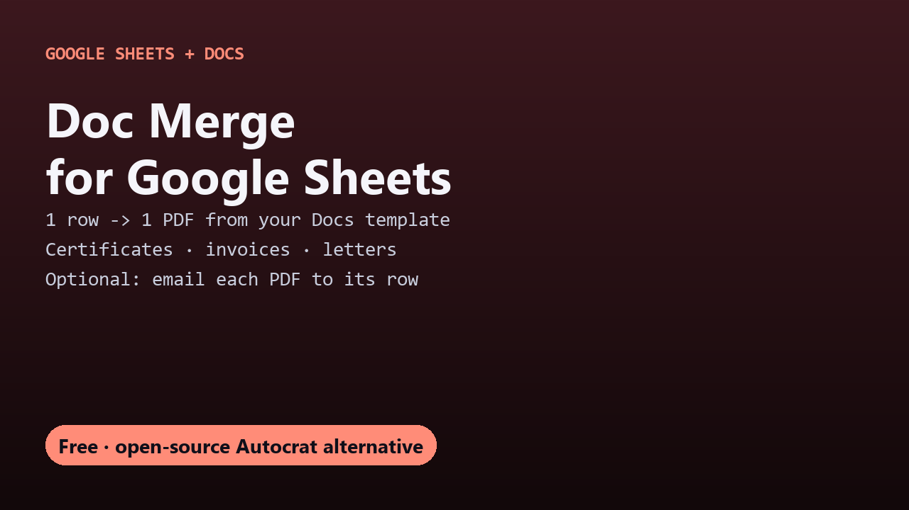

# Free Doc Merge for Google Sheets

One PDF per row of a Google Sheet from a Google Docs template, optionally emailed: certificates, invoices, letters. Free and open source.

## Guides

- [How to generate PDFs and certificates from Google Sheets](generate-pdfs-certificates-from-google-sheets.html)

## Get it

The script and full instructions are on GitHub: [DecodedXR/sheets-doc-merge](https://github.com/DecodedXR/sheets-doc-merge). It's MIT licensed and free.
